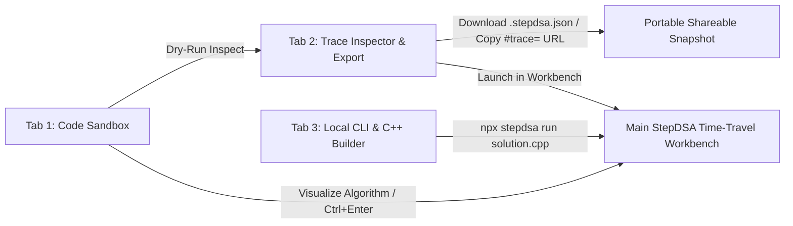

# 🎨 StepDSA Personal Code Studio v2.0 & Multi-Language Tracing Guide

  
  
  
  
  
  

**StepDSA Personal Code Studio (BYOC — Bring Your Own Code)** turns custom JavaScript/TypeScript, Python, and C++17 solutions into interactive, time-traveling visualizations with synchronized line highlighting, live array pointers, recursive Call Stack frames, and a Python-Tutor-style Heap & Memory Inspector.

---

## ⚡ Multi-Language Execution Matrix

| Language | Runtime Environment | Tracing Mechanism | Visual Stage Renderers |
| :--- | :--- | :--- | :--- |
| **JavaScript / TypeScript** | In-Browser Web Studio + Local CLI | V8 ES6 `Proxy` + AST Function & Line Instrumentation | `ArrayStage` (Bars + Pointers + Hash Map Strip) & `CallStackStage` |
| **Python 3** | In-Browser Pyodide WebAssembly | `sys.settrace()` Line, Frame, List & Dict Capture | `ArrayStage` & `CallStackStage` (Call Stack + Heap Objects) |
| **C++ (17/20)** | Dual-Mode: In-Browser Simulator + Local `g++`/`clang++` CLI | In-Browser Deterministic Vector/DFS Simulator or Native CLI | `ArrayStage` & `CallStackStage` via direct run or `#trace=` URL |

---

## 🧭 3-Tab Studio Architecture

Click **`>_ CLI Studio`** in the top header to access three integrated developer workspaces:

### 1️⃣ Tab 1: Code Sandbox (`JS / TS` · `Python WASM` · `C++ 17/20`)
- **10 Built-In Algorithm Templates:** Switch languages and click any preset pill to load ready-to-run algorithms:
  - **JS / TS:** *Generate Parentheses (DFS)*, *Bubble Sort (In-Place Swaps)*, *Binary Search (Two Pointers)*, *Two Sum (Hash Map)*
  - **Python (WASM):** *Two Sum (Hash Map)*, *Bubble Sort (Python List)*, *Climbing Stairs (Memo DFS)*
  - **C++ 17/20:** *C++ Generate Parentheses*, *C++ Vector Bubble Sort*, *C++ Binary Search*
- **IDE Editor Features:**
  - Synchronized **Line-Number Gutter (`1..N`)**
  - `Tab` key 2-space indentation
  - **`Ctrl + Enter` / `Cmd + Enter`** keyboard shortcut to trace and launch immediately
  - **Drag-and-Drop** or **`Import File`** for `.js`, `.ts`, `.py`, `.cpp`, `.stepdsa`, and `.stepdsa.json` files
  - **`Save File`** button to download `solution.js`, `solution.py`, or `solution.cpp` directly to disk

### 2️⃣ Tab 2: Trace Inspector & Snapshot Exporter
Before or without leaving the modal, click **`Dry-Run Inspect`** (or the **`Trace Inspector`** tab) to audit the captured execution:
- **Telemetry Summary Cards:** Displays **Captured Frames**, **Detected Stage (`ArrayStage + Pointers` vs `CallStack + Heap`)**, **Max Call Stack Depth**, and **Category Tag**.
- **Step-by-Step Timeline Table:** Inspect every captured frame's step index (`#0..#N`), active source line (`L1..LN`), explanation, and top Call Stack signature.
- **1-Click Export & Sharing:**
  - **`Download .stepdsa.json`:** Saves a self-contained JSON snapshot that anyone can drag-and-drop into StepDSA.
  - **`Copy Shareable URL`:** Compresses the entire timeline with `lz-string` into a `#trace=...` URL ready to share with students or teammates.

### 3️⃣ Tab 3: Local CLI & C++ Command Builder
- **Interactive Command Builder:** Choose between `stepdsa run`, `stepdsa trace`, `stepdsa init`, and `stepdsa doctor`, toggle `--dev`, `--no-open`, and `--verbose` flags, and copy the exact terminal command in 1 click.

---

## 🧠 Python-Tutor-Style Heap & Call Stack Visualization

When tracing recursive algorithms (such as *Generate Parentheses* or *Climbing Stairs*) or hash-map algorithms (such as *Two Sum*), StepDSA automatically renders:

1. **Active Call Stack Column:**
   - Displays every live stack frame from `#1` (root caller) up to `#N` (`ACTIVE` top frame) with parameter chips (`open: 2`, `close: 3`, `s: "("`).
2. **Live Heap & Memory State Column:**
   - **List / Array Objects (`res[]`, `nums[]`):** Visual indexed memory cells showing elements added in real time.
   - **Dictionary / Hash Map Objects (`lookup{}`, `memo{}`):** Two-column `Key → Value` hash table updating on every insertion.
   - **Active Scope Bindings:** Scalar local variables (`diff`, `target`, `returnVal`) highlighted for the current step.
